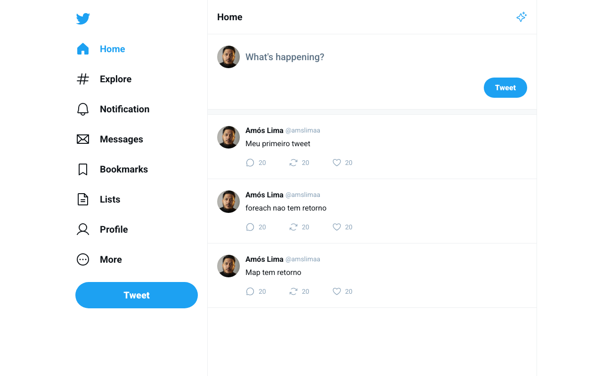

# 🐦 Twitter UI

Clone da interface do Twitter (timeline) construído para praticar React com TypeScript: menu lateral, caixa de composição e lista de tweets (com página de detalhe por tweet) e contadores de respostas, retweets e curtidas. Faz parte dos estudos da trilha **Ignite (Rocketseat)**.



## Tecnologias

React 18 · TypeScript · Vite · React Router · Phosphor Icons

## Como rodar

```bash
npm install
npm run dev     # http://localhost:5173
```

Outros scripts: `npm run build` e `npm run preview`.

## Autor

Feito por [Amós Magalhães](https://github.com/amslimaa).
